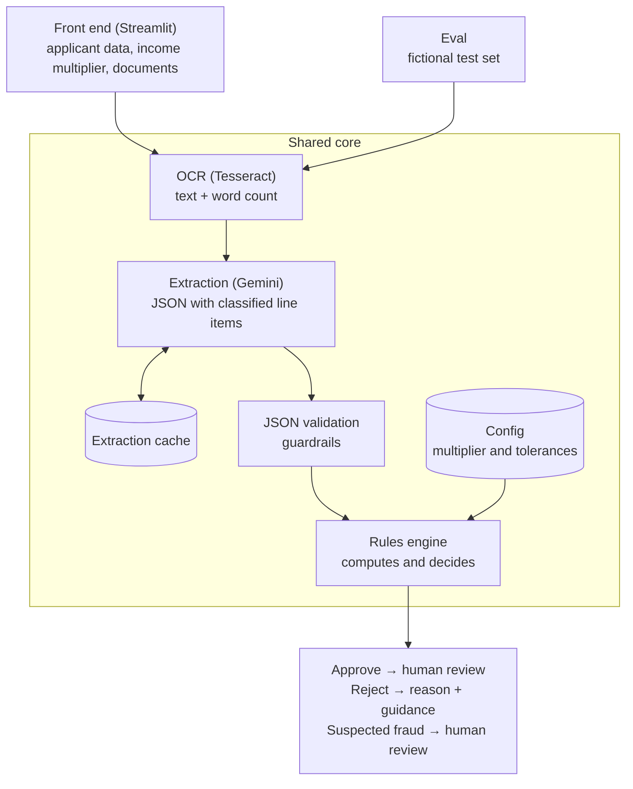

# AI pre-screening for proof-of-income documents

**Live demo:** https://pre-filtro-renda.streamlit.app/

**English** · [Português](README.pt-BR.md)

In lending, every pay stub goes through an analyst before a contract is signed. This manual review can take hours or even days, and many documents never had a chance: an unreadable photo, the wrong document, insufficient income. Applicants learn too late what they needed to fix, and may give up and turn to a competitor.

This pre-screening tool reviews the pay stub as soon as it is submitted:

- **AI reads:** OCR and an LLM check whether the image is readable; the LLM extracts the data and classifies every line on the pay stub.
- **Code decides:** deterministic, auditable rules compute the income and make the decision.
- **The applicant knows what to do:** approvals go on to an analyst; rejections come with the reason and how to fix it; uncertain cases go straight to human review.

> **Personal AI product lab.** Not a production product. All data, rules and documents are fictional. Built to practice, end to end, what an AI PM needs to master: prompting, structured output, evals, guardrails, cost and latency.

**Status:** v1 complete: rules engine, evals on the synthetic set and on 20 phone photos, extraction prompt v4 and a [public demo](https://pre-filtro-renda.streamlit.app/). Next: validate the legibility gate on new, held-out photos, including photos of printed pay stubs.

---

## The problem

In lending operations, every proof of income has to be checked before a contract is signed. When that check is 100% manual:

- every document costs analyst time, including the ones that never had a chance (unreadable photo, wrong file, someone else's document);
- the customer waits hours for an answer and, when rejected, often doesn't know what to fix;
- the document step becomes a bottleneck between the intent to borrow and the signed contract.

This project explores a product question: **how much of that check can be resolved automatically and safely, and where does a human remain essential?**

## Why build it: the value proposition

| Side | Value hypothesis | How to measure | Measurable in this lab? |
|---|---|---|---|
| **Operations** | Less analysis time and cost: cases that could never pass are resolved before they reach an analyst | % of cases resolved without a human; % of AI approvals reversed by the human reviewer | Partially (rates on the test set) |
| **Customer experience** | An answer in seconds instead of hours, with the reason for rejection and what to fix | Latency per document; % of rejections with actionable guidance | Yes (latency and reasons) |
| **Business** | A shorter contracting step and higher conversion to a signed contract | Duration of the document step; conversion to signed contract | No: requires real traffic; stays a hypothesis |

The right-hand column is intentional: a lab proves whether the machine works, not its impact on conversion. That distinction defines what this project can and cannot claim.

## How it works



**Core principle: the LLM reads, the code decides.** The model extracts and classifies every line item on the pay stub (e.g. "base salary: counts as income"; "overtime: doesn't count"). Every calculation and every decision lives in deterministic code. Why:

- LLMs make arithmetic mistakes and shouldn't make credit decisions on their own;
- the decision is auditable: you can explain exactly why a customer was rejected;
- when something goes wrong, you can tell whether it was a reading error (the LLM) or a rule error (the code).

Details in [`architecture.md`](architecture.md) and the full rule set in [`rules.md`](rules.md).

## Key product decisions

Every decision, with its rationale and the alternatives discarded, is logged in [`decisions.md`](decisions.md). The most relevant:

1. **Prompting + a rules engine instead of fine-tuning or RAG.** The rules are few, stable and fit in the prompt; fine-tuning would require a dataset labeled line by line and retraining for every rule change.
2. **v1 covers pay stubs only.** Bank statements have an open problem (telling the income of someone who sells as an individual apart from a one-off transfer) and were moved to v2. Any other file is rejected with a single, actionable message: "we currently accept pay stubs only".
3. **Humans review approvals, not rejections.** This focuses analysts where the credit risk is, but makes the **false negative** (rejecting someone who should pass) the critical error, because nobody reviews it. That's why automatic rejection only happens with high certainty.
4. **Legibility decided by code from checkable signals, not by the LLM's self-assessment.** A document is unreadable when the OCR finds no words and the LLM extracts nothing, or when the CPF fails its check digits. The OCR's average confidence was tried first and dropped: on real photos it blocked documents the LLM read correctly.
5. **Public demo without uploads.** The demo uses only fictional documents with cached extractions: zero cost, no risk of receiving real documents, and instant responses.

## How I evaluate it

The eval runs at two levels:

- **Document:** did the LLM read it correctly? Accuracy per field (pay period, tax ID, amounts) and per classified line item.
- **Applicant:** is the final decision right? Confusion matrix across approve, reject and human review.

**Test set:** 32 fictional applicants (~100 pay stubs generated by code), with ~50% that should be approved and ~50% that shouldn't. The set is deliberately enriched: every path of every rule appears at least once, including edge cases (income at 2.98× and 3.02× the installment), overtime that would flip the decision, an unreadable document, a mismatched name and a pay stub containing a prompt injection. The expected decisions were labeled by hand. Scenarios in [`test-scenarios.md`](test-scenarios.md).

**Why overall accuracy isn't enough:** in a set where 75% of applicants should be approved, a system that approves everyone scores 75%. Metrics are reported per class, with the false negative rate front and center.

## Results

All numbers come from the reports in [`evaluation/results/`](evaluation/results/) and from the API logs (`_log.csv`) in `cache/`. Unless noted: model `gemini-3.5-flash-lite`, extraction prompt v4, rules configuration v3.

### Decision per applicant (34 synthetic applicants)

The oracle feeds the engine the ground truth, as if the LLM read every document perfectly; end to end uses the LLM's cached extraction.

| Metric | Oracle | End to end |
|---|---|---|
| Right decision | 34/34 (100%) | 34/34 (100%) |
| Right main reason | 34/34 (100%) | 34/34 (100%) |
| approve | 17/17 | 17/17 |
| reject | 14/14 | 14/14 |
| review | 3/3 | 3/3 |
| False negatives (should approve, was rejected) | 0/17 | 0/17 |

In both modes, the valid income matched the ground truth to the cent in all 31 applicants where it can be compared.

### Extraction per document (116 scored documents, 98 of them pay stubs)

| Metric | Result |
|---|---|
| Pay stub fields (pay period, name, CPF, total earnings, total deductions, net pay) | 98/98 each (100%) |
| Earnings lines found | 132/132 |
| Earnings lines classified right (counts / doesn't count as income) | 132/132 |
| Earnings line amounts right | 132/132 |
| Document type | 113/116 (97.4%) |
| Invented fields (filled where the ground truth is empty) | 0 |
| Fraud flag on pay stubs | 98/98 right (1 detected, 0 false alarms, 0 missed) |
| Capture type on pay stubs | 97/98 (99.0%) |

The 3 document type errors swap one non-accepted type for another (the two annual income statements read as tax returns, a credit card bill read as a bank statement). No non-payslip document was read as a pay stub, so no decision changes. The blurred document is left out of the scored set.

### Cost and reliability

Same prompt (v2) and same test set for both models:

| Metric | gemini-3.5-flash-lite | gemini-3.8-flash |
|---|---|---|
| Documents extracted | 98 | 10 |
| Field accuracy on the documents extracted | 100% | 100% |
| API error rate | 1/99 (1.0%) | 11/21 (52.4%): 7 × 503, 3 timeouts, 1 × 429 |
| Latency p50 / p90 | 23.04 s / 55.80 s | 40.27 s / 65.64 s |
| Average tokens per document | 1,999 (0 reasoning) | 2,325 (333 reasoning) |

On phone photos the gap was wider: Lite extracted 9 of 9 photos with no errors (p50 2.79 s), while 3.8 Flash extracted 2 of 10, with 8 errors (p50 162.10 s) and 3,764 reasoning tokens per photo on average.

Lite across three runs of the test set, on 2026-10-26 and 2026-10-27 (prompts v2, v3 and v4):

| Metric | Range |
|---|---|
| Latency p50 | 2.59 s to 23.04 s |
| Latency p90 | 6.67 s to 55.80 s |
| API error rate | 0/117 (0%) to 1/99 (1.0%) |
| Average tokens per document | 1,999 to 2,279 |

### Phone photos (20)

Each photo replaces its source document in the applicant's set, and the engine decides again.

| Metric | Result |
|---|---|
| Right applicant decision | 18/20 |
| Recoverable rejections of readable photos (the applicant is asked to resend) | 2 |
| Wrong final decisions | 0 |
| Fields and lines right (19 readable photos) | 141/155 (91.0%) |
| Capture type right | 20/20 |
| Readable photos blocked by the legibility gate | 2 |
| Unreadable photos let through | 0 |

The 2 recoverable rejections are blurred photos in which the LLM read a CPF with invalid check digits. These results were measured on the same photos used to design the legibility gate, so they tend to be optimistic; validation on new photos is pending.

### How to read these numbers

The synthetic test set is saturated: both the oracle and the end-to-end run hit 100%, so it no longer tells good versions apart. Those 100% are the ceiling of what the set measures, not the performance on real documents. The phone photos are where the gaps show (91.0% of fields and lines right), and they are also the smallest sample.

## Known limitations

- Small, synthetic and saturated test set: the numbers show how the system behaves in the tested scenarios, not its performance on real documents.
- The phone photo results were measured on the same 20 photos used to design the legibility gate; validation on new, held-out photos is pending.
- False alarms of the screen capture rule (a photo of a printed pay stub classified as a photo of a screen, which would be wrongly rejected) are not measured yet: the photo set has no photos of paper.
- On a cropped photo, the LLM can fill in a total that isn't visible by copying a line amount; in the photo set this happened once and would change the decision if screen photos were accepted.
- Some non-accepted documents are confused with each other (3 of 116 documents): the decision doesn't change, but the message names the wrong document type.
- Latency on the free tier varies a lot from day to day for the same model and set.
- Vacation pay issued before the pay period can inflate one month and deflate another; in v1, the pay period printed on the document prevails.
- Pay stubs only in v1; bank statements, social security benefits, tax returns and owner's draw are mapped in [`rules.md`](rules.md) as backlog.

## What I'd do differently

### Decisions I had to undo

- **OCR as the only legibility check.** On phone photos, OCR confidence blocked images the LLM read correctly and let through the ones that mattered. What worked were checks on what the LLM read: valid CPF check digits, and both readers failing together.
- **Screen photos flagged as fraud.** A photo of a monitor isn't an attack; it's a product requirement. Treating it as a recoverable rejection with a clear instruction kept the review desk for real suspicion.
- **Net pay as income.** It looked closer to what reaches the applicant's account, but it carries every line on the stub, including temporary ones like overtime and the vacation bonus. Gross fixed pay, classified line by line, is more accurate and easier to audit.

**Choosing a model is an experiment, not an assumption.** I started with the newest model, assuming it would be the best. On this task, an older Lite model matched its accuracy at about half the latency, failed far less often and had 25 times the free-tier quota. I'd benchmark candidate models from day one.

**Tokens are more than input and output.** Reasoning ("thinking") tokens also consume quota and add latency. Here they changed nothing: the model that didn't reason scored the same. Newer isn't automatically better for a reading task.

## Stack

Python · Gemini API (free tier, Flash models) · Tesseract OCR · Streamlit · Claude Code

## How to run

> Partial: covers what exists today (test set generation, OCR, extraction, rules engine and evals). The Streamlit demo will be added when it is built.

**Requirements:** Python 3.15 (official installer from python.org), Tesseract OCR with the Portuguese model and, only for the extraction step, a Gemini API key.

**Installing Tesseract on an Intel Mac without Homebrew (MacPorts):**

1. Install MacPorts with the official `.pkg` for your macOS version from https://www.macports.org/install.php (the Xcode Command Line Tools must be installed).
2. In a new terminal:
   ```bash
   sudo port selfupdate
   sudo port install tesseract tesseract-por
   tesseract --list-langs     # must list "por"
   ```

Versions used for the OCR word count: **Tesseract 5.5.3** (Leptonica 1.87.0), Portuguese model from the **`tesseract-por` 4.1.0** port (standard `tessdata` family), page segmentation `--psm 3`. The word count can change with the Tesseract version or the language model; rerun the evals if either changes. `core/ocr.py` finds the binary on the `PATH` or in `/opt/local/bin`; set `TESSERACT_CMD` to use another location.

```bash
# 1. Create the virtual environment and install the pinned dependencies
python3.15 -m venv .venv
.venv/bin/pip install -r requirements.txt

# 2. Gemini API key (only needed for calls to the API)
cp .env.example .env    # then fill in GEMINI_API_KEY= in .env; it is git-ignored

# 3. Regenerate the test set (no API calls; fixed seed, reproducible)
.venv/bin/python generation/generate_data.py     # data/*.csv + an ok/failed check per applicant
.venv/bin/python generation/generate_images.py   # data/images/*.png + data/images/_sample.png

# 4. OCR legibility signal (local, no API calls)
.venv/bin/python -m core.ocr                     # writes cache/ocr/confidence.csv

# 5. Extraction with Gemini (uses quota; cached per prompt version and model)
.venv/bin/python evaluation/extract.py --prompt extraction_v2 --model gemini-3.5-flash-lite --min-interval 4 --all

# 6. Tests and evals (local, no API calls)
.venv/bin/python -m pytest
.venv/bin/python evaluation/score_documents.py --prompt extraction_v2 --model gemini-3.5-flash-lite
.venv/bin/python evaluation/score_applicants.py --source oracle
.venv/bin/python evaluation/score_applicants.py --source cache --model gemini-3.5-flash-lite
```

The test set, the OCR confidences and the extractions are already committed, so steps 3 to 5 are optional: tests and evals run offline from the repository. The images use macOS system fonts; on another system they may differ slightly.

---

**About me:** Suzane Lima, Product Manager with a background in fintech, credit and growth. [LinkedIn](https://www.linkedin.com/in/suzane-lima)
