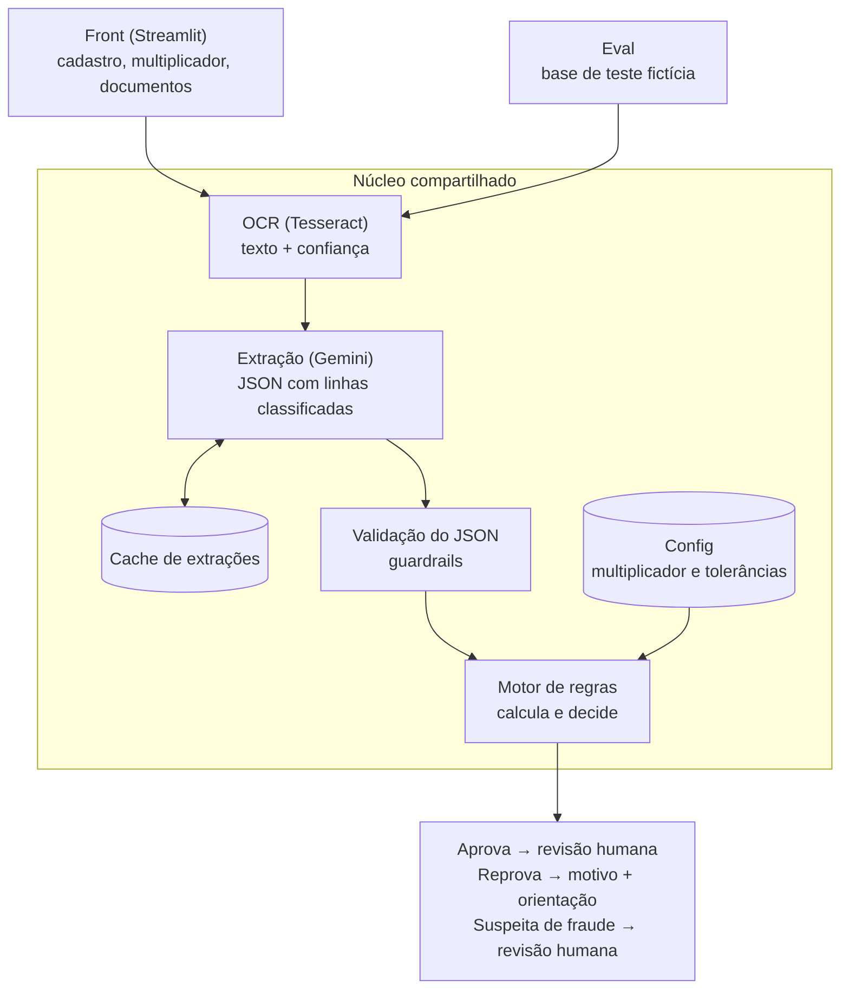

# Pré-filtro de comprovantes de renda com IA

[English](README.md) · **Português**

Um pré-filtro que lê holerites, extrai os dados com um LLM e aplica regras de crédito em código para aprovar, reprovar ou encaminhar cada caso para revisão humana.

> **Laboratório pessoal de produto de IA.** Não é um produto em produção. Todos os dados, regras e documentos são fictícios. Construído para praticar, de ponta a ponta, o que um PM de IA precisa dominar: prompts, structured output, evals, guardrails, custo e latência.

**Status:** em construção. Regras, arquitetura e base de teste definidas; extração e evals em andamento.

---

## O problema

Em operações de crédito, todo comprovante de renda precisa ser conferido antes da contratação. Quando essa conferência é 100% manual:

- cada documento custa tempo de analista, inclusive os que nunca teriam chance de passar (foto ilegível, arquivo errado, documento de outra pessoa);
- o cliente espera horas pela resposta e, quando é reprovado, muitas vezes não sabe o que corrigir;
- a etapa de documentos vira um gargalo entre a intenção de contratar e a contratação de fato.

Este projeto explora uma pergunta de produto: **quanto dessa conferência dá para resolver automaticamente, com segurança, e onde o humano continua indispensável?**

## Por que construir: a proposta de valor

| Lado | Hipótese de valor | Como medir | Mensurável neste laboratório? |
|---|---|---|---|
| **Operações** | Menos tempo e custo de análise: casos que não teriam como passar são resolvidos antes de chegar ao analista | % de casos resolvidos sem humano; % de aprovações da IA que o humano reverte | Parcialmente (taxas sobre a base de teste) |
| **Experiência do cliente** | Resposta em segundos em vez de horas, com o motivo da reprovação e o que corrigir | Latência por documento; % de reprovações com orientação acionável | Sim (latência e motivos) |
| **Negócio** | Etapa de contratação mais curta e mais conversão até a formalização | Tempo da etapa de documentos; conversão até a formalização | Não: exige tráfego real; fica como hipótese |

A coluna da direita é intencional: um laboratório prova se a máquina funciona, não o impacto em conversão. Essa distinção define o que este projeto pode e não pode afirmar.

## Como funciona

**Princípio central: o LLM lê, o código decide.** O modelo extrai e classifica cada linha do holerite (por exemplo, "salário-base: conta como renda"; "hora extra: não conta"). Toda conta e toda decisão ficam em código determinístico. Motivos:

- LLMs erram aritmética e não devem decidir crédito sozinhos;
- a decisão fica auditável: dá para explicar exatamente por que um cliente foi reprovado;
- quando algo dá errado, dá para saber se o erro foi de leitura (o LLM) ou de regra (o código).

Detalhes em [`architecture.md`](architecture.md) e nas regras completas em [`rules.md`](rules.md) (documentação do repositório em inglês).

## Principais decisões de produto

Todas as decisões, com motivo e alternativas descartadas, estão em [`decisions.md`](decisions.md). As mais relevantes:

1. **Prompting + motor de regras, em vez de fine-tuning ou RAG.** As regras são poucas, fixas e cabem no prompt; fine-tuning exigiria base rotulada linha a linha e retreino a cada mudança de regra.
2. **Escopo da v1 só com holerite.** Extrato bancário tem um problema aberto (distinguir a renda de quem vende como pessoa física de uma transferência pontual) e ficou para a v2. Qualquer outro arquivo é reprovado com uma mensagem única e acionável: "no momento aceitamos apenas holerite".
3. **Humano revisa as aprovações, não as reprovações.** Isso concentra o analista onde está o risco de crédito, mas torna o **falso negativo** (reprovar quem deveria passar) o erro crítico, porque ninguém o revisa. Por isso, a reprovação automática só acontece com alta certeza.
4. **Legibilidade medida pela confiança do OCR, não pela autoavaliação do LLM.** Um sinal numérico e estável é calibrável; a opinião do modelo sobre a própria leitura, não.
5. **Demo pública sem upload.** A demo usa só documentos fictícios com extrações em cache: custo zero, nenhum risco de receber documento real e resposta instantânea.

## Como eu avalio

O eval roda em dois níveis:

- **Documento:** o LLM leu certo? Acurácia por campo (competência, CPF, valores) e por linha classificada.
- **Cliente:** a decisão final está certa? Matriz de confusão entre aprova, reprova e revisão humana.

**Base de teste:** 32 clientes fictícios (~100 holerites gerados por código), com ~50% de casos que devem ser aprovados e ~50% que não. A base é enriquecida de propósito: cada caminho de cada regra aparece pelo menos uma vez, incluindo casos de borda (renda de 2,98× e 3,02× a parcela), hora extra que mudaria a decisão, documento ilegível, nome divergente e um holerite com prompt injection. O gabarito de decisão foi preenchido à mão. Cenários em [`test-scenarios.md`](test-scenarios.md).

**Por que não usar só a acurácia geral:** numa base em que 75% dos clientes deveriam ser aprovados, um sistema que aprova todo mundo acerta 75%. As métricas são reportadas por classe, com o falso negativo em destaque.

## Resultados

> Em construção. Os números abaixo serão preenchidos com os resultados dos evals rodados neste repositório.

| Métrica | OCR + LLM | LLM lendo a imagem |
|---|---|---|
| Acurácia por linha classificada | — | — |
| Acurácia dos valores extraídos | — | — |
| Acerto da decisão final | — | — |
| Taxa de falso negativo | — | — |
| Latência média por documento | — | — |
| Tokens por documento | — | — |

## Limitações conhecidas

- Base pequena e sintética: os números mostram o comportamento do sistema nos cenários testados, não a performance em documentos reais.
- Férias pagas antes da competência podem inflar um mês e reduzir outro; na v1, vale a competência escrita no documento.
- Só holerite na v1; extrato, benefício do INSS, IR e pró-labore estão mapeados em [`rules.md`](rules.md) como backlog.

## O que eu faria diferente

> A preencher ao fim do projeto.

## Stack

Python · Gemini API (plano gratuito, modelos Flash) · Tesseract OCR · Streamlit · Claude Code

## Como rodar

> A preencher quando o código estiver pronto.

---

**Sobre mim:** Suzane Lima, Product Manager com background em fintech, crédito e growth. [LinkedIn](https://www.linkedin.com/in/suzane-lima)
