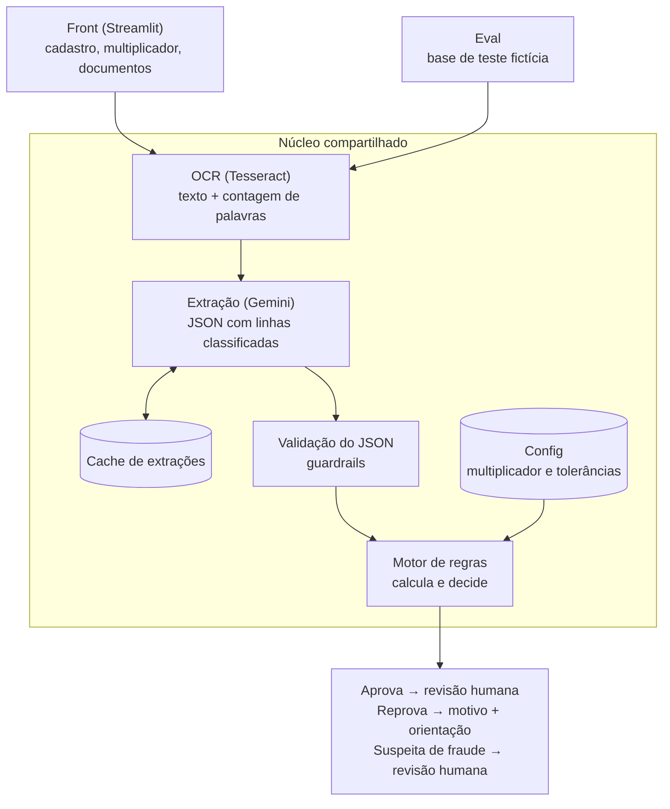

# Pré-filtro de comprovantes de renda com IA

**Demo:** https://pre-filtro-renda.streamlit.app/

[English](README.md) · **Português**

Em operações de crédito, todo holerite passa por um analista antes da contratação. Essa análise manual pode levar horas ou até dias, e muitos documentos nunca teriam chance de ser aprovados: foto ilegível, documento errado, renda insuficiente. O cliente descobre tarde o que precisava corrigir e pode desistir e procurar a concorrência.

Este pré-filtro analisa o holerite assim que ele é enviado:

- **A IA lê:** um OCR e um LLM verificam se a imagem está legível; o LLM extrai os dados e classifica cada linha do holerite.
- **O código decide:** regras determinísticas e auditáveis calculam a renda e tomam a decisão.
- **O cliente sabe o que fazer:** aprovado segue para um analista; reprovado recebe o motivo e como corrigir; casos de dúvida vão direto para revisão humana.

> **Laboratório pessoal de produto de IA.** Não é um produto em produção. Todos os dados, regras e documentos são fictícios. Construído para praticar, de ponta a ponta, o que um PM de IA precisa dominar: prompts, structured output, evals, guardrails, custo e latência.

**Status:** em construção. Regras, arquitetura e base de teste (dados e imagens) prontas, e o smoke test do Gemini passou; extração e evals em andamento.

---

## O problema

Em operações de crédito, todo comprovante de renda precisa ser conferido antes da contratação. Quando essa conferência é 100% manual:

- cada documento custa tempo de analista, inclusive os que nunca teriam chance de passar (foto ilegível, arquivo errado, documento de outra pessoa);
- o cliente espera horas pela resposta e, quando é reprovado, muitas vezes não sabe o que corrigir;
- a etapa de documentos vira um gargalo entre a intenção de contratar e a contratação de fato.

Este projeto explora uma pergunta de produto: **quanto dessa conferência dá para resolver automaticamente, com segurança, e onde o humano continua indispensável?**

## Por que construir: a proposta de valor

| Lado | Hipótese de valor | Como medir | Mensurável neste laboratório? |
|---|---|---|---|
| **Operações** | Menos tempo e custo de análise: casos que não teriam como passar são resolvidos antes de chegar ao analista | % de casos resolvidos sem humano; % de aprovações da IA que o humano reverte | Parcialmente (taxas sobre a base de teste) |
| **Experiência do cliente** | Resposta em segundos em vez de horas, com o motivo da reprovação e o que corrigir | Latência por documento; % de reprovações com orientação acionável | Sim (latência e motivos) |
| **Negócio** | Etapa de contratação mais curta e mais conversão até a formalização | Tempo da etapa de documentos; conversão até a formalização | Não: exige tráfego real; fica como hipótese |

A coluna da direita é intencional: um laboratório prova se a máquina funciona, não o impacto em conversão. Essa distinção define o que este projeto pode e não pode afirmar.

## Como funciona



**Princípio central: o LLM lê, o código decide.** O modelo extrai e classifica cada linha do holerite (por exemplo, "salário-base: conta como renda"; "hora extra: não conta"). Toda conta e toda decisão ficam em código determinístico. Motivos:

- LLMs erram aritmética e não devem decidir crédito sozinhos;
- a decisão fica auditável: dá para explicar exatamente por que um cliente foi reprovado;
- quando algo dá errado, dá para saber se o erro foi de leitura (o LLM) ou de regra (o código).

Detalhes em [`architecture.md`](architecture.md) e nas regras completas em [`rules.md`](rules.md) (documentação do repositório em inglês).

## Principais decisões de produto

Todas as decisões, com motivo e alternativas descartadas, estão em [`decisions.md`](decisions.md). As mais relevantes:

1. **Prompting + motor de regras, em vez de fine-tuning ou RAG.** As regras são poucas, fixas e cabem no prompt; fine-tuning exigiria base rotulada linha a linha e retreino a cada mudança de regra.
2. **Escopo da v1 só com holerite.** Extrato bancário tem um problema aberto (distinguir a renda de quem vende como pessoa física de uma transferência pontual) e ficou para a v2. Qualquer outro arquivo é reprovado com uma mensagem única e acionável: "no momento aceitamos apenas holerite".
3. **Humano revisa as aprovações, não as reprovações.** Isso concentra o analista onde está o risco de crédito, mas torna o **falso negativo** (reprovar quem deveria passar) o erro crítico, porque ninguém o revisa. Por isso, a reprovação automática só acontece com alta certeza.
4. **Legibilidade decidida por código a partir de sinais verificáveis, não pela autoavaliação do LLM.** Um documento é ilegível quando o OCR não acha nenhuma palavra e o LLM não extrai nada, ou quando o CPF falha nos dígitos verificadores. A confiança média do OCR foi testada antes e descartada: em fotos reais, barrava documentos que o LLM lia bem.
5. **Demo pública sem upload.** A demo usa só documentos fictícios com extrações em cache: custo zero, nenhum risco de receber documento real e resposta instantânea.

## Como eu avalio

O eval roda em dois níveis:

- **Documento:** o LLM leu certo? Acurácia por campo (competência, CPF, valores) e por linha classificada.
- **Cliente:** a decisão final está certa? Matriz de confusão entre aprova, reprova e revisão humana.

**Base de teste:** 32 clientes fictícios (~100 holerites gerados por código), com ~50% de casos que devem ser aprovados e ~50% que não. A base é enriquecida de propósito: cada caminho de cada regra aparece pelo menos uma vez, incluindo casos de borda (renda de 2,98× e 3,02× a parcela), hora extra que mudaria a decisão, documento ilegível, nome divergente e um holerite com prompt injection. O gabarito de decisão foi preenchido à mão. Cenários em [`test-scenarios.md`](test-scenarios.md).

**Por que não usar só a acurácia geral:** numa base em que 75% dos clientes deveriam ser aprovados, um sistema que aprova todo mundo acerta 75%. As métricas são reportadas por classe, com o falso negativo em destaque.

## Resultados

> Em construção. Os números abaixo serão preenchidos com os resultados dos evals rodados neste repositório.

| Métrica | OCR + LLM | LLM lendo a imagem |
|---|---|---|
| Acurácia por linha classificada | — | — |
| Acurácia dos valores extraídos | — | — |
| Acerto da decisão final | — | — |
| Taxa de falso negativo | — | — |
| Latência média por documento | — | — |
| Tokens por documento | — | — |

## Limitações conhecidas

- Base pequena e sintética: os números mostram o comportamento do sistema nos cenários testados, não a performance em documentos reais.
- Férias pagas antes da competência podem inflar um mês e reduzir outro; na v1, vale a competência escrita no documento.
- Só holerite na v1; extrato, benefício do INSS, IR e pró-labore estão mapeados em [`rules.md`](rules.md) como backlog.

## O que eu faria diferente

### Decisões que precisei desfazer

- **O OCR como única checagem de legibilidade.** Nas fotos de celular, a confiança do OCR barrou imagens que o LLM lia corretamente e deixou passar as que importavam. O que funcionou foram checagens sobre o que o LLM leu: dígitos verificadores do CPF e os dois leitores falhando juntos.
- **Foto de tela marcada como fraude.** Foto de monitor não é ataque; é um requisito de produto. Tratá-la como reprovação recuperável, com instrução clara, deixou a mesa de revisão para as suspeitas reais.
- **Renda líquida.** Parecia mais próxima do que cai na conta do cliente, mas carrega todas as linhas do holerite, inclusive as temporárias, como hora extra e o 1/3 de férias. A renda bruta fixa, classificada linha a linha, é mais precisa e mais fácil de auditar.

**Escolher o modelo é um experimento, não uma premissa.** Comecei com o modelo mais recente, supondo que seria o melhor. Nesta tarefa, um modelo Lite mais antigo empatou em acurácia, com cerca de metade da latência, muito menos falhas e 25 vezes mais cota gratuita. Eu compararia modelos desde o primeiro dia.

**Tokens não são só entrada e saída.** Os tokens de raciocínio também consomem cota e aumentam a latência. Aqui, não mudaram nada: o modelo que não raciocinou teve o mesmo resultado. Mais novo não é automaticamente melhor para uma tarefa de leitura.

## Stack

Python · Gemini API (plano gratuito, modelos Flash) · Tesseract OCR · Streamlit · Claude Code

## Como rodar

> Parcial: cobre o que existe hoje (geração da base de teste, OCR, extração, motor de regras e evals). A demo em Streamlit entra quando for construída.

**Requisitos:** Python 3.15 (instalador oficial do python.org), Tesseract OCR com o modelo de português e, só para a etapa de extração, uma chave da API do Gemini.

**Instalando o Tesseract num Mac Intel sem Homebrew (MacPorts):**

1. Instale o MacPorts pelo `.pkg` oficial da sua versão do macOS em https://www.macports.org/install.php (é preciso ter as Command Line Tools do Xcode).
2. Num terminal novo:
   ```bash
   sudo port selfupdate
   sudo port install tesseract tesseract-por
   tesseract --list-langs     # precisa listar "por"
   ```

Versões usadas na contagem de palavras do OCR: **Tesseract 5.5.3** (Leptonica 1.87.0), modelo de português do port **`tesseract-por` 4.1.0** (família `tessdata` padrão), segmentação `--psm 3`. A contagem de palavras pode mudar com a versão do Tesseract ou com o modelo de idioma; rode os evals de novo se algum deles mudar. O `core/ocr.py` procura o programa no `PATH` ou em `/opt/local/bin`; defina `TESSERACT_CMD` para usar outro local.

```bash
# 1. Criar o ambiente virtual e instalar as dependências com versões fixas
python3.15 -m venv .venv
.venv/bin/pip install -r requirements.txt

# 2. Chave da API do Gemini (só para chamadas à API)
cp .env.example .env    # depois preencha GEMINI_API_KEY= no .env; ele é ignorado pelo git

# 3. Regenerar a base de teste (sem chamar API; semente fixa, reproduzível)
.venv/bin/python generation/generate_data.py     # data/*.csv + checagem ok/falhou por cliente
.venv/bin/python generation/generate_images.py   # data/images/*.png + data/images/_sample.png

# 4. Sinal de legibilidade pelo OCR (local, sem chamar API)
.venv/bin/python -m core.ocr                     # grava cache/ocr/confidence.csv

# 5. Extração com o Gemini (gasta cota; cache por versão de prompt e modelo)
.venv/bin/python evaluation/extract.py --prompt extraction_v2 --model gemini-3.5-flash-lite --min-interval 4 --all

# 6. Testes e evals (locais, sem chamar API)
.venv/bin/python -m pytest
.venv/bin/python evaluation/score_documents.py --prompt extraction_v2 --model gemini-3.5-flash-lite
.venv/bin/python evaluation/score_applicants.py --source oracle
.venv/bin/python evaluation/score_applicants.py --source cache --model gemini-3.5-flash-lite
```

A base de teste, as confianças do OCR e as extrações já estão no repositório, então os passos 3 a 5 são opcionais: os testes e os evals rodam offline a partir do repositório. As imagens usam fontes do sistema do macOS; em outro sistema podem sair um pouco diferentes.

---

**Sobre mim:** Suzane Lima, Product Manager com background em fintech, crédito e growth. [LinkedIn](https://www.linkedin.com/in/suzane-lima)
