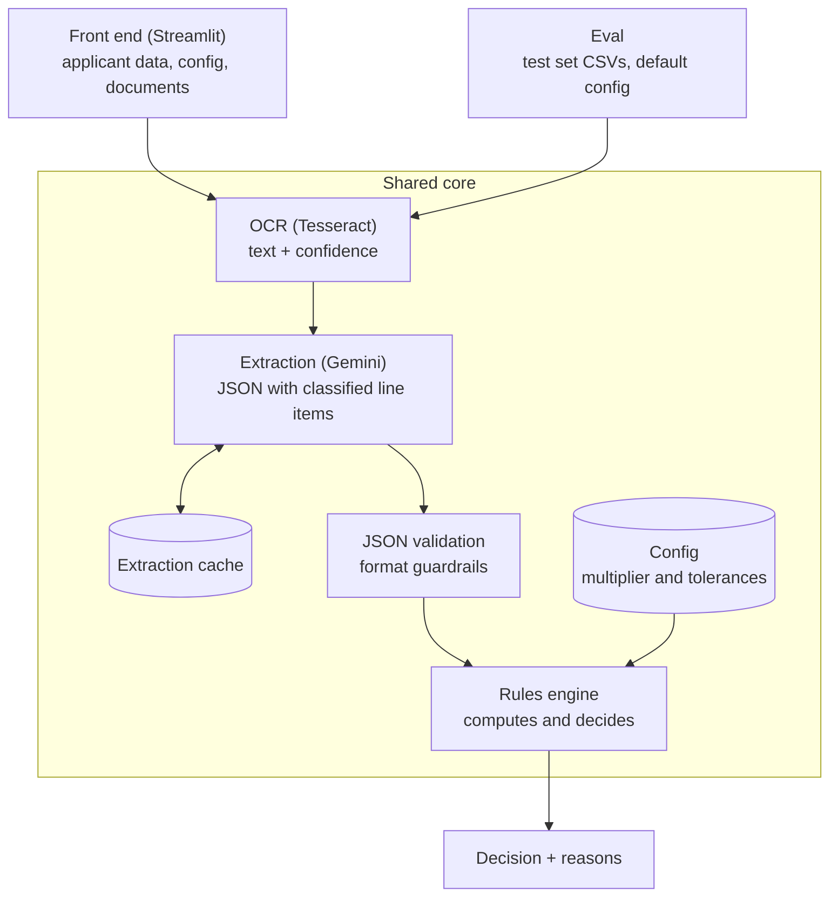

# Architecture

> Personal lab. Draft v0.1 (2026-10-24).

## Overview



Only the extraction step calls the Gemini API and uses quota. Everything else is local code, at no cost.

## Principles

1. **One core, two entry points.** The front end and the eval call the same code; only the data source changes. The eval numbers measure exactly the system behind the demo.
2. **Parameters as configuration.** The income multiplier, tolerances and similarity thresholds live in a configuration file read by the engine; the front end lets the user change the multiplier (income commitment). `analysis_date` is an input parameter: the front end passes today's date, and the eval passes the fixed date from the applicant record.
3. **Extraction cache.** Each document's JSON is stored per document and prompt version. Changing a rule reruns only the engine, without new API calls.
4. **Independent rules.** Each rule receives the JSON and the applicant record and returns: pass, fail or review, plus the reason.

## Risks and design decisions

- **Eval comparability:** results are valid only for the configuration they were measured with. Each eval run records the configuration version.
- **Public demo:** uses only the fictional test set, with cached extractions; it accepts no uploads and makes no API calls. Uploads with real API calls only when running locally.

## Folder structure (proposed)

```
pre-filtro-ia-docs-renda/
├── core/              # shared code
│   ├── ocr.py
│   ├── extraction.py  # Gemini call + JSON schema
│   ├── validation.py  # guardrails
│   ├── rules/         # one rule per file
│   └── engine.py
├── config/
│   └── default_rules.yaml
├── data/              # fictional test set: CSVs and images
├── generation/        # scripts that generate the test set
├── cache/             # stored extractions
├── evaluation/        # runs the eval and computes metrics
├── app/               # Streamlit front end
├── rules.md
├── decisions.md
├── test-scenarios.md
└── architecture.md
```
