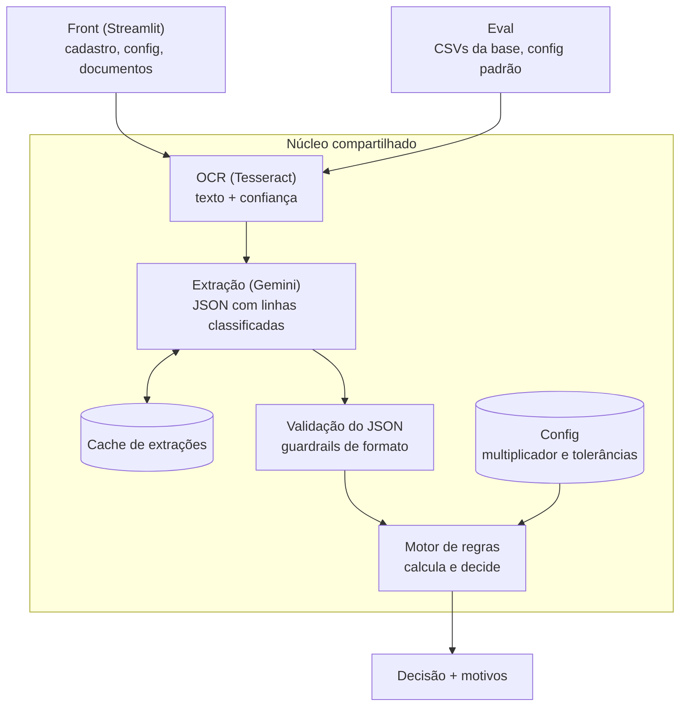

# Arquitetura

> Laboratório pessoal. Rascunho v0.1 (24/10/2026).

## Visão geral



Só a etapa de extração chama a API do Gemini e gasta cota. Todo o resto é código local, sem custo.

## Princípios

1. **Um núcleo, duas entradas.** O front e o eval chamam o mesmo código; muda só a origem dos dados. Os números do eval medem exatamente o sistema da demo.
2. **Parâmetros como configuração.** Multiplicador, tolerâncias e limites de similaridade ficam num arquivo de configuração lido pelo motor; o front permite ao usuário mudar o multiplicador (comprometimento de renda). A `data_analise` é um parâmetro de entrada: o front passa a data de hoje, e o eval passa a data fixa do cadastro.
3. **Cache de extrações.** O JSON de cada documento fica salvo por documento e versão de prompt. Mudar uma regra reroda só o motor, sem nova chamada à API.
4. **Regras independentes.** Cada regra recebe o JSON e o cadastro e devolve: passou, falhou ou revisão, mais o motivo.

## Riscos e decisões de desenho

- **Comparabilidade do eval:** os resultados valem só para a configuração em que foram medidos. Cada execução do eval registra a versão da configuração.
- **Demo pública:** usa só a base fictícia, com as extrações em cache; não aceita upload nem faz chamadas à API. Upload com chamada real só na execução local.

## Estrutura de pastas (proposta)

```
pre-filtro-ia-docs-renda/
├── nucleo/            # código compartilhado
│   ├── ocr.py
│   ├── extracao.py    # chamada ao Gemini + esquema do JSON
│   ├── validacao.py   # guardrails
│   ├── regras/        # uma regra por arquivo
│   └── motor.py
├── config/
│   └── regras_padrao.yaml
├── dados/             # base fictícia: CSVs e imagens
├── cache/             # extrações salvas
├── avaliacao/         # roda o eval e calcula as métricas
├── app/               # front em Streamlit
├── regras.md
├── decisoes.md
└── arquitetura.md
```